# Chroma Shop — Documentación final

Natalia Paredes Cambindo
**Universidad Autónoma de Occidente**  
**Asignatura:** Desarrollo de Aplicaciones Móviles  
**Periodo:** 2026-2

> **Video demostrativo:** [Ver en YouTube](https://youtu.be/sGBc7XLv4K4)

> **Aplicación web:** <https://chroma-shop-front.onrender.com>

> **Lovable:** [Prototipo](https://lovable.dev/projects/132cc8a3-d1bf-4fba-9f4c-984185dd36bf?magic_link=mc_0c4e7b76-1cfc-42ae-9243-5885f16778cb)

## 1. Introducción

Chroma Shop es una aplicación móvil de comercio electrónico de maquillaje que integra un diagnóstico de colorimetría para recomendar tonalidades y productos personalizados. La solución combina una aplicación Android, una interfaz web, servicios backend y una base de datos en la nube.

## 2. Problema y objetivos

La compra de maquillaje por internet dificulta identificar tonalidades adecuadas sin probar físicamente los productos. El objetivo es reducir esa incertidumbre mediante recomendaciones personalizadas y facilitar el proceso de compra.

Los objetivos técnicos son implementar navegación móvil, autenticación real, persistencia local y remota, acceso a capacidades nativas, transacciones de inventario, consumo de APIs y comunicación en tiempo real.

## 3. Alcance

| Cliente | Administrador |
|---|---|
| Registro e inicio de sesión | Acceso con permisos administrativos |
| Diagnóstico rápido y completo | Creación y edición de productos |
| Paleta y recomendaciones | Gestión de precios y existencias |
| Catálogo, filtros y favoritos | Retiro de productos del catálogo |
| Carrito y compra contra entrega | Consulta y actualización de pedidos |
| Historial y seguimiento | Corrección de estados |
| GPS, tiendas y fotografía de perfil | Gestión de inventario |

El alcance corresponde a un prototipo funcional académico. No incluye pasarela de pagos electrónicos ni integración logística comercial. Las tiendas registradas para la demostración son ejemplos.

## 4. Diseño y prototipado

El diseño inicial se desarrolló con Lovable. La implementación conserva la identidad visual y los flujos principales del prototipo, adaptándolos a los componentes de Ionic.

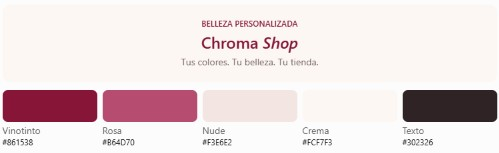

*Figura 1. Identidad visual del prototipo.*

| Color | Código |
|---|---|
| Vinotinto | `#861538` |
| Rosa | `#B64D70` |
| Nude | `#F3E6E2` |
| Crema | `#FCF7F3` |
| Texto | `#302326` |

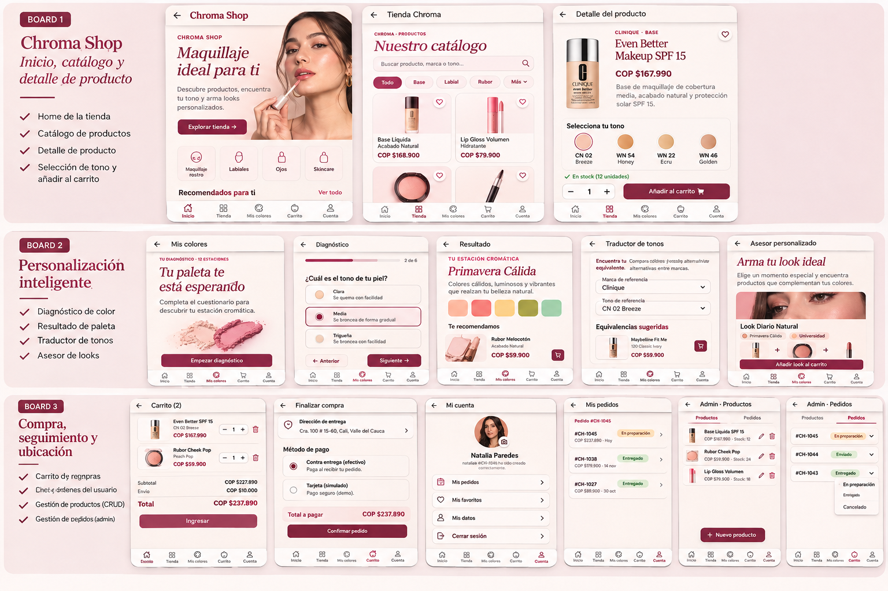

*Figura 2. Inicio y catálogo, personalización, compra y administración.*


*Figura 3. Inicio, diagnóstico de color, carrito y cuenta.*


*Figura 4. Variante de las pantallas de inicio, paleta, compra y cuenta.*

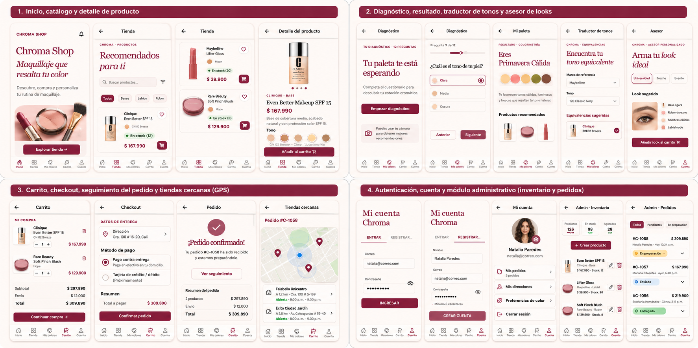

*Figura 5. Conjunto de interfaces propuestas por módulo. Las figuras 2–5 corresponden a material de diseño, no a pruebas de ejecución.*

## 5. Arquitectura del sistema

Se utiliza una arquitectura cliente-servidor con servicios gestionados en la nube. El frontend consume tanto las APIs REST de FastAPI como los servicios de Supabase. Firebase Cloud Messaging se utiliza para la entrega de notificaciones Android.

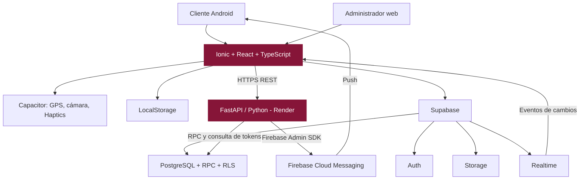

*Figura 6. Arquitectura lógica de Chroma Shop.*

El frontend web y el backend se despliegan como servicios independientes en Render. La versión Android empaqueta el frontend mediante Capacitor y utiliza los mismos servicios remotos.

## 6. Tecnologías utilizadas

| Tecnología | Aplicación en el proyecto |
|---|---|
| Ionic React | Componentes de interfaz móvil, formularios y navegación |
| React | Componentes reutilizables, estado y renderizado |
| TypeScript | Tipado de componentes y modelos |
| Vite | Desarrollo y compilación del frontend |
| React Router | Navegación entre pantallas |
| React Context | Estado compartido de la tienda |
| Custom hooks | Encapsulación de lógica reutilizable, como geolocalización y push |
| Capacitor | Integración Android y acceso a funcionalidades nativas |
| LocalStorage | Persistencia local del carrito |
| Python y FastAPI | Diagnóstico, recomendaciones y lógica de notificaciones |
| Supabase Auth | Registro e inicio de sesión |
| PostgreSQL | Persistencia relacional |
| Supabase Storage | Fotografías de perfil |
| Supabase Realtime | Eventos de actualización de pedidos |
| Firebase Cloud Messaging | Notificaciones push Android |
| Render | Despliegue de frontend y backend |
| Git y GitHub | Control de versiones e integración de ramas |
| Lovable | Prototipado de interfaces |

## 7. Organización del código

La solución separa el frontend del backend. La siguiente estructura es un resumen lógico de los componentes principales, no un inventario exhaustivo.

```text
Chroma.shop/
├── chroma-shop/
│   ├── android/
│   ├── public/
│   └── src/
│       ├── components/
│       ├── context/
│       ├── hooks/
│       ├── pages/
│       ├── services/
│       └── App.tsx
├── chroma-shop-backend/
│   ├── app.py
│   ├── push.py
│   └── requirements.txt
└── Documentación/
```

React Context centraliza el estado compartido, mientras que los custom hooks encapsulan lógica de acceso a servicios y funcionalidades nativas. Las pantallas y los componentes reutilizables se separan para facilitar el mantenimiento.

## 8. Base de datos

Supabase proporciona una instancia PostgreSQL que almacena usuarios, catálogo, pedidos y otros datos de la aplicación.

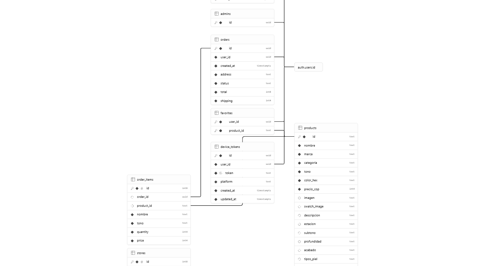

*Figura 7. Esquema de base de datos suministrado como evidencia.*

| Entidad | Responsabilidad |
|---|---|
| `profiles` | Información del perfil |
| `admins` | Identificación de administradores |
| `products` | Catálogo, precios e inventario |
| `favorites` | Productos favoritos |
| `orders` | Encabezado y estado de pedidos |
| `order_items` | Productos y cantidades de cada pedido |
| `stores` | Ubicaciones de tiendas |
| `device_tokens` | Tokens de notificaciones asociados al usuario |

La autenticación se integra con `auth.users`. Las políticas Row Level Security (RLS) limitan el acceso según el usuario y sus permisos.

## 9. React, navegación y estado

Ionic permite construir interfaces adaptadas a dispositivos móviles. React Router organiza la navegación, y React Context permite compartir información entre catálogo, carrito y otras pantallas sin pasar propiedades por todos los niveles de componentes.

El carrito utiliza LocalStorage para conservar su contenido localmente. La información persistente de pedidos, perfiles y catálogo se mantiene en Supabase. Esta separación permite distinguir memoria local de persistencia remota.

## 10. Autenticación y seguridad

Supabase Auth gestiona el registro e inicio de sesión real. El sistema diferencia los roles cliente y administrador y restringe las operaciones administrativas mediante permisos y políticas de base de datos. La interfaz por sí sola no constituye el control de seguridad.

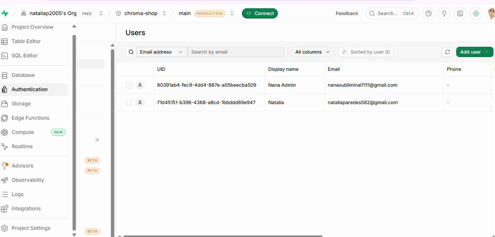

*Figura 8. Usuarios registrados en Supabase Authentication.*

Las credenciales privadas del backend, incluyendo la clave de servicio de Supabase y las credenciales de Firebase Admin, se configuran como variables de entorno del servidor y no deben publicarse en GitHub ni incluirse en el frontend.

## 11. Diagnóstico y consumo de backend

El usuario responde un cuestionario rápido o completo. El backend procesa sus respuestas para determinar una estación de colorimetría y recomendar productos y tonalidades. La aplicación presenta la paleta y las recomendaciones obtenidas.

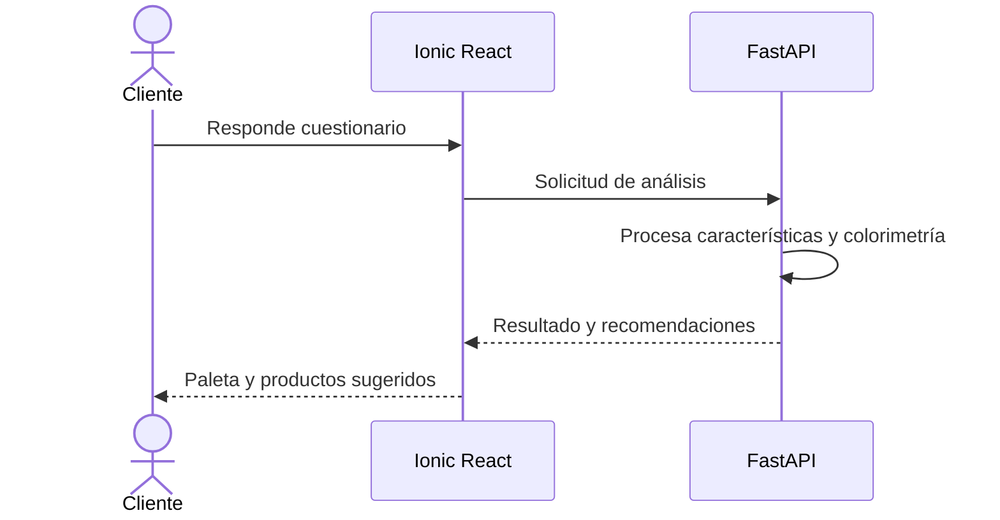

*Figura 9. Flujo lógico del diagnóstico.*

### Servicios del backend

URL base: <https://chroma-shop.onrender.com>

| Ruta | Finalidad |
|---|---|
| `/health` | Comprobación de disponibilidad |
| `/api/questionnaire` | Consulta del cuestionario |
| `/api/analyze` | Análisis de colorimetría |
| `/api/recommend` | Recomendaciones |
| `/api/translator` | Equivalencias de tonalidades |
| `/api/advisor` | Asesoría de maquillaje |

El backend también dispone de lógica de actualización de pedidos y envío de notificaciones. La ruta exacta y los métodos HTTP deben contrastarse con el código final o con la documentación OpenAPI antes de cerrar el README. La existencia de un endpoint no implica que todos se consuman desde la interfaz.

## 12. Sensores y capacidades nativas

### GPS y mapas

Capacitor Geolocation obtiene las coordenadas del usuario previa autorización. La sección de tiendas utiliza ubicaciones registradas para calcular distancias y mostrar información geográfica. El GPS también se utiliza en el flujo de entrega, según la demostración realizada.

### Cámara

Capacitor Camera permite capturar una fotografía para el perfil. La imagen se guarda en Supabase Storage y se asocia a la cuenta, permitiendo recuperarla posteriormente.

### Haptics

Capacitor Haptics genera una respuesta vibratoria al agregar productos al carrito. Es una capacidad de retroalimentación física, no un sensor de medición.

## 13. Transacciones y gestión del inventario

La compra contra entrega ejecuta una operación transaccional en PostgreSQL mediante una función RPC. Se valida la disponibilidad, se registra el pedido y sus artículos y se descuentan las existencias. El bloqueo de filas permite controlar compras concurrentes sobre el mismo producto.

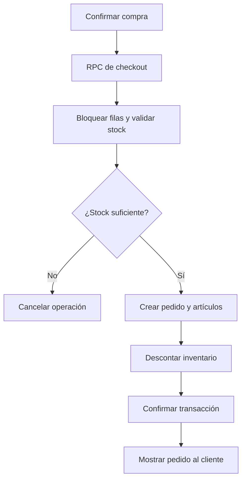

*Figura 10. Flujo transaccional de compra.*

En la demostración descrita, el inventario de un producto pasa de 12 a 10 unidades después de dos compras. Esta comprobación evidencia la actualización de existencias; la atomicidad se apoya en la implementación de la función de base de datos.

## 14. Panel administrativo

El administrador puede gestionar el catálogo, modificar precios y cantidades, retirar productos y consultar pedidos. También puede avanzar o corregir el estado de un pedido.

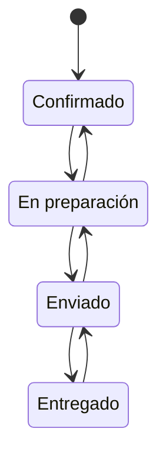

*Figura 11. Estados del pedido y correcciones permitidas.*

## 15. Comunicación en tiempo real y Firebase

Supabase Realtime y Firebase Cloud Messaging cumplen funciones distintas. Realtime comunica cambios de base de datos a la aplicación suscrita; FCM entrega notificaciones push al dispositivo, incluso cuando la aplicación no está en primer plano.

Al iniciar sesión en Android se registra un token del dispositivo asociado al usuario. Cuando el administrador cambia el estado de un pedido, el backend valida la operación, actualiza la base de datos y utiliza Firebase Admin SDK para notificar al cliente.

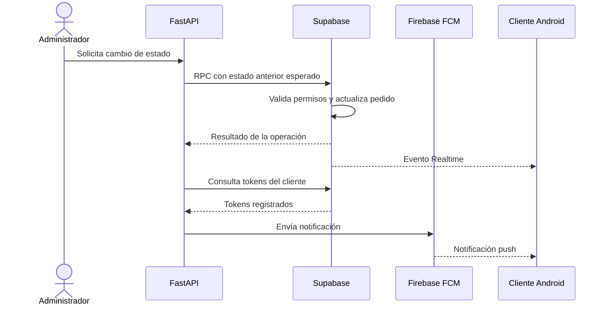

*Figura 12. Flujo de actualización y notificaciones.*

La función de cambio de estado verifica el estado anterior esperado para evitar actualizaciones sobre información desactualizada. Cuando el estado retrocede, se envía una notificación de corrección.

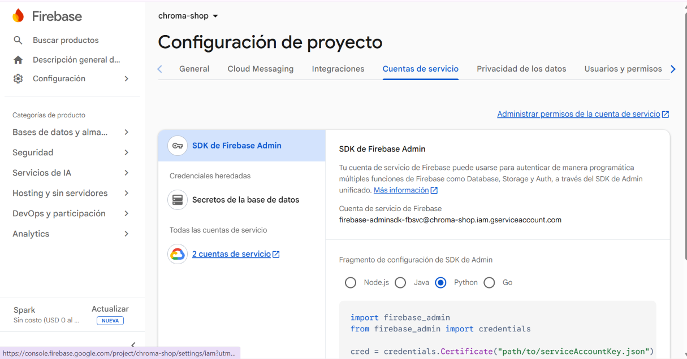

*Figura 13. Configuración de la cuenta de servicio de Firebase Admin SDK en el proyecto chroma-shop.*

La recepción de una notificación push fue comprobada durante el desarrollo. La sincronización Realtime debe evidenciarse por separado mediante una actualización visible sin recargar la pantalla.

## 16. Despliegue y control de versiones

El frontend web y FastAPI se alojan en Render. Android se genera mediante Capacitor y Android Studio. Supabase y Firebase operan como servicios externos.

El repositorio Git organiza los cambios mediante ramas y su integración en `main`.


## 17. Conclusiones

Chroma Shop integra los conocimientos del curso en una solución móvil que combina comercio electrónico, personalización, persistencia de datos y capacidades nativas. La separación entre frontend, backend y servicios de nube facilita el mantenimiento y la evolución del sistema.

La integración de transacciones, autenticación, comunicación en tiempo real y notificaciones permite desarrollar un flujo completo desde el diagnóstico hasta el seguimiento de pedidos.

## 18. Enlaces del proyecto

- **Video demostrativo (3:32):** [Ver en YouTube](PEGAR_LINK_YOUTUBE)
- **Backend (Render):** <https://chroma-shop.onrender.com>
- **Aplicación web (Render):** <https://chroma-shop-front.onrender.com>
